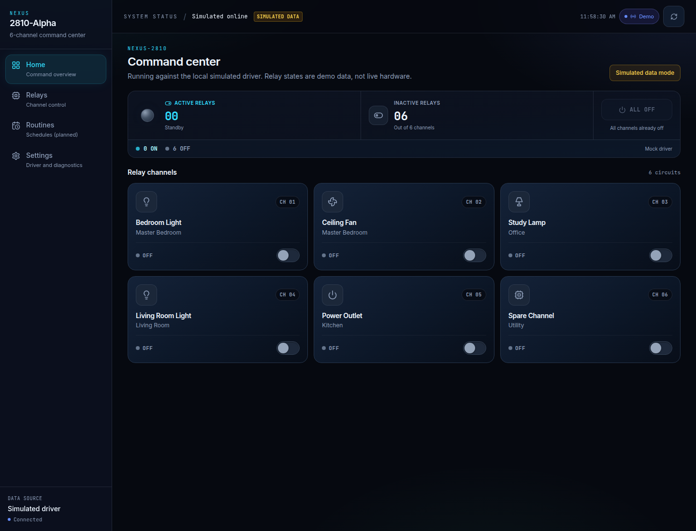
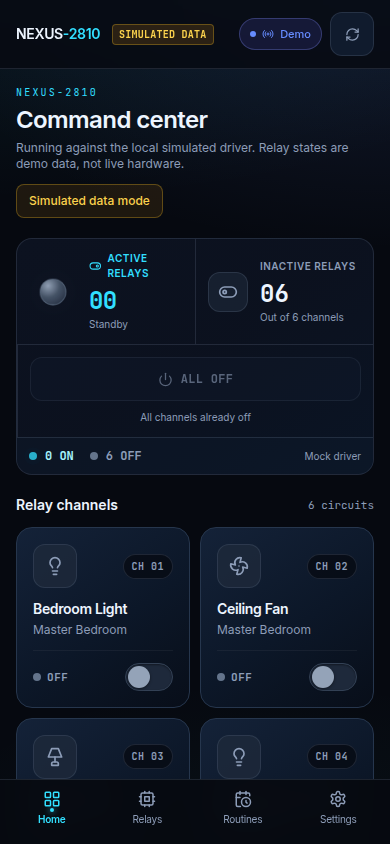
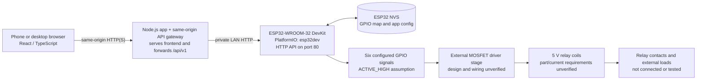

# NEXUS-2810-Alpha

A six-channel smart-home command center built with a React web application and firmware for a classic ESP32-WROOM-32 DevKit profile. The firmware exposes an HTTP API and GPIO control interface for an external relay-driver circuit.

> **Hardware status:** The firmware has compiled, uploaded, booted, joined Wi-Fi, started its HTTP server, and passed read-only API checks. The relay module is not connected. GPIO assignments, the driver circuit, relay polarity, coil power, and physical relay operation have **not** been validated against hardware. Do not connect a relay module or loads based on the firmware assumptions alone.


<p align="center">
  
</p>


## Contents

- [Features](#features)
- [Architecture](#architecture)
- [Hardware and electrical requirements](#hardware-and-electrical-requirements)
- [Software requirements](#software-requirements)
- [Quick start: firmware setup and upload](#quick-start-firmware-setup-and-upload)
- [Wi-Fi configuration](#wi-fi-configuration)
- [Web app setup and controller connection](#web-app-setup-and-controller-connection)
- [HTTP API](#http-api)
- [Troubleshooting](#troubleshooting)
- [Safety limitations and verification status](#safety-limitations-and-verification-status)
- [Testing and development](#testing-and-development)
- [Downloads and releases](#downloads-and-releases)

## Features

- Responsive React/TypeScript command center with six relay channels.
- Simulated demo mode for frontend development without hardware.
- ESP32 HTTP API for status, device details, app configuration, and relay commands.
- Firmware-owned GPIO allowlist and validated, staged relay mapping.
- Persistent mapping and app configuration using ESP32 NVS.
- Production Node.js gateway serving the frontend and proxying the ESP32 API.
- Bounded Wi-Fi startup wait and serial diagnostics at 115200 baud.
- Linux and Windows PowerShell setup scripts for PlatformIO build and upload.

<p align="center">
  
</p>

## Architecture



The firmware reports software-command state only. It has no relay-contact or load feedback, so neither the API nor the interface can confirm physical actuation or load state.

## Hardware and electrical requirements

### Known project configuration

| Item | Current project value | Verification status |
|---|---|---|
| MCU profile | Classic ESP32-WROOM-32 DevKit; PlatformIO `esp32dev` | Firmware build/upload and startup verified; exact board revision/pinout not confirmed |
| Relay channels | Six | Software configuration only; physical module not connected |
| Default channel GPIOs | 16, 17, 18, 19, 21, 22 | Firmware defaults; not yet continuity-checked against the actual board |
| Additional firmware-allowed GPIOs | 23, 25, 26, 27, 32, 33 | Firmware allowlist only; verify the exact board and circuit before use |
| Firmware relay polarity | `ACTIVE_HIGH`; software OFF command is LOW | Assumption only; actual driver input polarity is unverified |
| Relay coil supply | 5 V relay coils, per project design description | Coil part number, current, supply capacity, and isolation requirements are not yet verified |
| Driver | ESP32 GPIO signals to MOSFET drivers | MOSFET part, gate network, schematic, protection, and wiring are not provided/verified |
| Flyback protection | Required for inductive coils unless correctly provided by the driver/module | Presence, polarity, rating, and placement must be verified from the actual circuit |

The pin table is **not a wiring certification**. Do not remap pins to an unverified board. The firmware allowlist avoids several common ESP32 hazards, but a different DevKit layout or attached peripherals can change what is safe or available.

### Electrical requirements and wiring checklist

Before connecting the relay board or any load, obtain and inspect the exact ESP32 board, MOSFET driver, relay-coil, and power-supply datasheets and the circuit schematic. Verify all of the following:

1. **GPIO voltage and driver compatibility:** ESP32 GPIO is 3.3 V logic. Confirm the selected MOSFET is fully driven at the available gate voltage, stays within GPIO limits, and has an appropriate gate resistor and gate-to-source pull-down. Do not drive a 5 V coil directly from an ESP32 pin.
2. **Driver topology and common reference:** Confirm whether each MOSFET is low-side or high-side, the source/drain orientation, common-ground requirements, and any isolation. Use a common reference only when required by the verified design; do not defeat isolation.
3. **Flyback protection:** Verify a correctly rated flyback diode or equivalent clamp across each coil unless the selected module already provides it. Observe polarity and placement from the schematic and component datasheets.
4. **5 V supply:** Size the supply for the documented coil current and the maximum intended simultaneous channels, plus the required margin. The firmware and UI do not enforce a power budget.
5. **Relay contacts and loads:** Check contact voltage/current ratings, inrush, fusing, creepage/clearance, enclosure, strain relief, and load type. Mains wiring must be designed and inspected by a qualified person under applicable local rules.
6. **Power-up behavior:** Firmware configures outputs after reset, but cannot guarantee GPIO levels during reset, ROM boot, or before `setup()` executes. Provide suitable external biasing and/or a hardware enable interlock that defaults disabled, then verify behavior on the isolated driver before attaching coils.
7. **Commissioning:** Keep relay hardware and external loads disconnected during software startup tests. After the circuit has been independently reviewed, test the driver and each relay using a current-limited, appropriately fused setup before connecting any real load. Do not use the software's `stateCertain` as physical feedback.

No detailed wiring diagram is supplied because the MOSFET driver circuit and its protection have not been verified. A generic schematic could be unsafe for the actual module.

## Software requirements

- Ubuntu/Linux or Windows with a USB data cable.
- Python 3 and a network connection for the first PlatformIO installation (unless PlatformIO is already installed).
- PlatformIO Core. The setup scripts prefer a project-local `firmware/.venv` when one exists, otherwise reuse a detected PlatformIO installation, otherwise create the local environment.
- Node.js and npm for the web application; install the dependencies from `package-lock.json`.
- A modern browser for the web app.
- USB-to-serial driver for the specific DevKit. The board used in the verified upload appeared as a CP2102 USB-to-UART adapter; other board revisions may use another adapter.

## Quick start: firmware setup and upload

The scripts build the existing `firmware/platformio.ini` project and verify the configured target before uploading. Normal flashing does **not** erase flash or NVS. A successful build, upload, serial startup, HTTP check, and physical relay test are separate verification steps.

### Ubuntu/Linux

From the repository root:

```bash
chmod +x scripts/setup-and-flash.sh
./scripts/setup-and-flash.sh
```

The script sets up PlatformIO if needed, checks that the `esp32dev` profile is configured, builds, finds or asks for the serial port, and asks for confirmation that relay hardware and external loads are disconnected before uploading. After upload, it offers to open a 115200-baud serial monitor.

Options:

```bash
./scripts/setup-and-flash.sh --port /dev/ttyUSB0
./scripts/setup-and-flash.sh --build-only
./scripts/setup-and-flash.sh --port /dev/ttyUSB0 --no-monitor
```

The port can also be a stable path under `/dev/serial/by-id/`. On Ubuntu, if access is denied, check membership in `dialout`, add the account to that group if appropriate, then sign out and back in. The script does not change device permissions.

### Windows PowerShell

Open PowerShell in the repository root:

```powershell
.\scripts\setup-and-flash.ps1
```

If script execution is blocked, allow this script for the current PowerShell process only:

```powershell
Set-ExecutionPolicy -Scope Process Bypass
.\scripts\setup-and-flash.ps1
```

Options:

```powershell
.\scripts\setup-and-flash.ps1 -Port COM5
.\scripts\setup-and-flash.ps1 -BuildOnly
.\scripts\setup-and-flash.ps1 -Port COM5 -NoMonitor
```

Install the correct USB-to-serial driver for the board if no COM port appears. Do not disable system security policy globally to run the script.

### Wi-Fi credentials

On the first run, if the private header is missing, the script copies the safe template to `firmware/include/wifi_credentials.h` and stops before building. Edit that local file with the 2.4 GHz Wi-Fi SSID and password, then re-run the script. The header is excluded by `firmware/.gitignore`; scripts never overwrite it or print its contents.

The firmware uses the credentials at compile time. Never paste credentials into public scripts, README examples, issues, or commits. The example header contains placeholders only.

### Manual PlatformIO commands

After PlatformIO and the private Wi-Fi header are configured:

```bash
cd firmware
pio run -e esp32dev
pio device list
pio run -e esp32dev -t upload --upload-port /dev/ttyUSB0
pio device monitor --port /dev/ttyUSB0 --baud 115200
```

On Windows, replace the port with the board's COM port, for example `COM5`. PlatformIO may auto-detect the port; the scripts pass the selected port explicitly. Do not erase flash or NVS as a routine response to an upload or startup issue.

### Factory reset (separate, destructive operation)

There is no factory-reset endpoint in the firmware and the setup scripts never erase storage. The normal firmware stores the relay mapping and app configuration in NVS. A PlatformIO `erase` target erases the **entire flash**, including firmware and NVS; it is not a routine troubleshooting step.

Only if a deliberate full-device wipe is required, disconnect relay hardware and loads, identify and double-check the correct serial port, then run from `firmware/`:

```bash
pio run -e esp32dev -t erase --upload-port /dev/ttyUSB0
```

Use the corresponding COM port on Windows. This operation is destructive; afterward, upload firmware again and reconfigure Wi-Fi. Do not use it to fix a problem until the cause and consequences are understood.

## Web app setup and controller connection

Run the development app from the repository root:

```bash
npm ci
npm run dev
```

The development app uses simulated data by default on `localhost` and `127.0.0.1`; these values are not hardware readings. To use the development proxy, copy `.env.example` to `.env`, set `ESP32_DEV_TARGET` to the ESP32's LAN origin, restart Vite, then select **Real ESP32** in Settings and leave the API gateway address blank.

### Production hosting on the controller's LAN

The production backend is the included Node.js service in `server/index.mjs`. It serves `dist/` and forwards `/api/v1/...` requests to `ESP32_TARGET`. Host this service on a Linux machine or other Node.js host on the same reachable LAN as the ESP32, and open the service URL from the phone on that LAN. This single-origin arrangement does not depend on Vite and does not require firmware CORS changes.

```bash
cp .env.example .env
# Set ESP32_TARGET to the controller's current LAN origin in .env.
npm ci
npm run build
npm start
```

Set `PORT` (default `8080`), `HOST` (default `0.0.0.0`), and `ESP32_TIMEOUT_MS` (default `5000`) as needed. The frontend request timeout defaults to 6500 ms and should exceed the gateway timeout. `ALLOWED_ORIGIN` is an optional comma-separated exact-origin allowlist, used only when the browser app is hosted on a different origin; same-origin requests need no CORS allowlist. Do not put credentials or secrets in `VITE_*` variables. `VITE_API_BASE_URL` is a public gateway origin baked into the frontend build; leave it blank for the recommended same-origin deployment. A separately hosted frontend requires that public gateway URL and a matching `ALLOWED_ORIGIN`.

The API host must itself be able to reach the ESP32's private LAN address. A public static host or cloud backend cannot reach a private address automatically. Remote access requires a deliberately configured secure network gateway/VPN; do not expose the unauthenticated, unencrypted ESP32 API or this proxy to the public internet. The included Node service provides origin checks, bounded request sizes, and timeouts, but does not add user authentication or TLS. Put it behind a trusted LAN or a properly secured TLS/authentication gateway before broader access.

The firmware serves the API only; it does not host the frontend. Vite's `ESP32_DEV_TARGET` proxy is for development only; production uses the Node service.

## HTTP API

Firmware API base URL: `http://<controller-ip>`; JSON responses use `/api/v1`. The firmware API is unauthenticated, unencrypted, and has no CORS support. In the deployed app, the browser calls the Node gateway at same-origin `/api/v1`, and the gateway forwards to the configured ESP32 target. Restrict access to a trusted LAN. Do not send control requests during initial startup validation.

### Read endpoints

`GET /api/v1/status`

```json
{
  "revision": 1,
  "relays": [
    { "id": 1, "state": false },
    { "id": 2, "state": false },
    { "id": 3, "state": false },
    { "id": 4, "state": false },
    { "id": 5, "state": false },
    { "id": 6, "state": false }
  ],
  "uptimeSeconds": 123,
  "wifiRssi": -52,
  "freeHeap": 226964
}
```

`GET /api/v1/device` returns `model`, `firmware`, `chipId`, `mac`, and `ip`.

`GET /api/v1/config` returns the default device name and channel names/rooms. `PUT /api/v1/config` stores a JSON object with a string `deviceName` and returns the submitted JSON object. The current GET handler returns firmware defaults rather than reading the stored app configuration.

`GET /api/v1/config/relays` returns board/profile text, `polarity`, `supportedGpios`, active channel mappings, optional `stagedGpios`, `allRelaysOff`, `commandPending`, and `stateCertain`. The last field is software bookkeeping compatibility only; it is not physical feedback.

```json
{
  "board": "ESP32-WROOM-32 DevKit (esp32dev profile; verify exact board)",
  "polarity": "ACTIVE_HIGH",
  "supportedGpios": [16, 17, 18, 19, 21, 22, 23, 25, 26, 27, 32, 33],
  "activeGpios": [16, 17, 18, 19, 21, 22],
  "channels": [
    { "id": 1, "gpio": 16 }, { "id": 2, "gpio": 17 },
    { "id": 3, "gpio": 18 }, { "id": 4, "gpio": 19 },
    { "id": 5, "gpio": 21 }, { "id": 6, "gpio": 22 }
  ],
  "stagedGpios": null,
  "allRelaysOff": true,
  "commandPending": false,
  "stateCertain": true
}
```

### Control and mapping endpoints

> Control requests change GPIO outputs and may actuate physical equipment if a driver is connected. Keep hardware disconnected until the circuit and test plan are verified.

`PUT /api/v1/relays/{id}` with `{"state":true|false}` commands channel IDs 1–6. On success, the response includes `success`, `channelId`, `state`, and `revision`.

`PUT /api/v1/relays/all` with `{"state":false}` commands all six channels; `false` requests software OFF. Success returns `success`, `state`, and `revision`.

`PUT /api/v1/config/relays` validates and stages exactly six unique channel IDs and GPIOs from the firmware allowlist:

```json
{
  "channels": [
    { "id": 1, "gpio": 16 }, { "id": 2, "gpio": 17 },
    { "id": 3, "gpio": 18 }, { "id": 4, "gpio": 19 },
    { "id": 5, "gpio": 21 }, { "id": 6, "gpio": 22 }
  ]
}
```

This mapping example matches firmware defaults; it does **not** validate the physical board or circuit. Validation errors use HTTP 400 or 422. `POST /api/v1/config/relays/apply` persists a staged mapping in NVS only when no commanded relay is ON and no command is pending; otherwise it returns HTTP 409. Applying changes can alter which pins control external circuits, so verify all wiring before use.

## Troubleshooting

| Symptom | Checks |
|---|---|
| No serial port detected | Check the USB data cable, board power, USB-serial driver, and the OS device list. Do not assume a charge-only cable is suitable. |
| Linux permission denied | Verify the selected device and current `dialout` membership. Sign out/in after a group change; do not chmod the device globally. |
| `wifi_credentials.h` missing | The setup script copies the example once and exits. Edit the ignored local header and rerun. |
| Build reports missing credentials | Check only that the private header exists and placeholders were replaced; never publish its contents. |
| Wi-Fi timeout | Confirm 2.4 GHz network compatibility, router availability, signal, and local credential configuration. Serial logs do not reveal credentials. Firmware continues and starts its HTTP server even if Wi-Fi timed out. |
| Upload fails or serial port busy | Close other serial monitors, confirm the selected port, USB connection, and board bootloader/upload behavior. Avoid repeated resets or flash erases without evidence. |
| ROM output but no application logs | Confirm the flashed build contains startup diagnostics and monitor at 115200 baud. If the boot already occurred before attaching, open the monitor first and perform one deliberate reset with relay hardware disconnected. |
| Browser cannot connect to API | Check that `ESP32_TARGET` is reachable from the Node gateway host, verify the configured gateway URL and CORS origin if cross-origin, and confirm the gateway is running. The firmware itself does not implement browser CORS. |
| Reported state differs from physical state | The firmware cannot sense relay contacts or loads. Inspect the circuit safely; `stateCertain` does not mean hardware feedback. |

## Safety limitations and verification status

- **Verified in software/runtime:** PlatformIO build for `esp32dev`; firmware upload; application startup; NVS initialization; default GPIO mapping validation; Wi-Fi connection and HTTP server startup; read-only status, device, and relay-config API responses.
- **Not physically verified:** exact board pinout, actual MOSFET driver schematic/wiring, flyback protection, 5 V supply sizing, relay input polarity, GPIO-to-coil behavior, relay contact ratings, or any physical load.
- **No feedback:** relay states represent firmware command bookkeeping. `stateCertain: true` is retained for frontend compatibility and must not be interpreted as physical relay/load confirmation.
- **Reset behavior:** software does not guarantee safe GPIO levels during reset or before firmware initialization. Hardware biasing and a disabled-by-default interlock may be necessary.
- **Network security:** API requests are unauthenticated and unencrypted; current firmware does not implement browser CORS. Keep it off the public internet and untrusted networks.
- **No automatic actuation:** setup and startup diagnostics do not toggle relays. Keep the module and loads disconnected during initial commissioning.

## Testing and development

Frontend:

```bash
npm ci
npm test
npm run build
npm run dev
```

Firmware:

```bash
cd firmware
pio run -e esp32dev
```

The firmware build requires the ignored local `include/wifi_credentials.h`. The setup scripts offer repeatable environment setup, build, upload, and optional serial monitoring. `--build-only` / `-BuildOnly` does not require connected hardware. A successful compile does not prove a successful upload; a successful upload does not prove serial startup, HTTP connectivity, or physical relay operation.

Read-only device verification (does not issue relay commands or write configuration):

```bash
python3 scripts/verify-esp32-readonly.py --base-url http://<controller-ip>
```

This checks the status, device, and active GPIO mapping API responses and reports controller-command state only. It does not test physical relay behavior or NVS persistence. Do not apply a new mapping until the board, connected pins, driver circuit, and relay/load OFF conditions have been independently confirmed safe.

## Downloads and releases

- **Clone source:** `git clone https://github.com/v-aryank/NEXUS-2810-Alpha.git`
- **Download source ZIP:** open the repository at [GitHub](https://github.com/v-aryank/NEXUS-2810-Alpha) and choose **Code → Download ZIP**. Configure the private Wi-Fi header after extracting.
- **Versioned firmware:** check the repository's [GitHub Releases](https://github.com/v-aryank/NEXUS-2810-Alpha/releases). Only download a firmware image if a versioned release actually publishes it and documents the board profile, firmware version, flash layout, and complete flashing instructions. This repository does not currently provide a checked-in, ready-to-flash release image.

To prepare a future firmware release, build with `esp32dev`, record the firmware version and PlatformIO/ESP32 platform configuration, inspect the flash/partition requirements, and package all files required by the documented flashing process. A lone `firmware.bin` may be only the application partition and is not necessarily a complete image. Generate a SHA-256 checksum for every published binary (`sha256sum <asset>` on Linux/macOS or `Get-FileHash <asset> -Algorithm SHA256` in PowerShell) and publish the checksum alongside the exact release asset. Do not publish Wi-Fi credentials or other local configuration.
